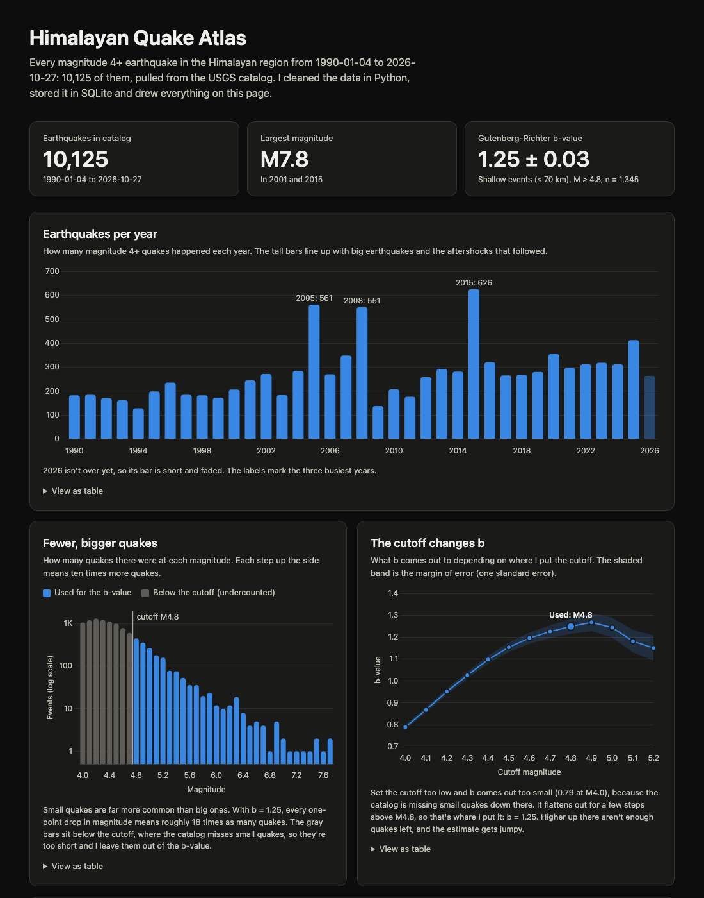

# Himalayan Quake Atlas

A Python and SQLite pipeline over 36 years of USGS earthquake data for the Himalayan region, with a Gutenberg-Richter b-value analysis and an interactive dashboard built with Chart.js and Leaflet.

**Live demo:** https://sulavsapkota2060.github.io/quake-atlas/



## Why I built it

I'm from Kathmandu, and the 2015 Gorkha earthquake is the event that shaped how a lot of people there think about the ground under them. I wanted to see the whole region's earthquake record in one place and ask one careful statistical question of it: how steeply do quakes get rarer as they get bigger, and how much should I trust the number I get?

This project describes what has already happened. It does not predict earthquakes.

## What it does

```
USGS API --fetch--> data/raw/*.csv --clean--> quake.db (SQLite) --analysis--> docs/data/summary.json --> website
```

1. **Fetch.** `fetch.py` downloads the USGS catalog for a box around the Himalayan arc, one CSV per year.
2. **Clean.** `clean.py` keeps real earthquakes, drops incomplete rows, removes duplicates, and labels each event with a region.
3. **Store.** `db.py` loads the cleaned table into SQLite. `sql/queries.sql` holds the exploratory queries.
4. **Analyse.** `analysis.py` estimates the Gutenberg-Richter b-value, its standard error, and how it changes with the completeness cutoff and by region, and writes `docs/data/summary.json`.
5. **Show.** `docs/` is a static site (HTML, CSS, Chart.js, Leaflet) that reads that JSON. It runs on GitHub Pages with no server.

## Results

Numbers below are from the catalog as downloaded on 2026-10-27.

**The catalog.** 10,125 earthquakes of magnitude 4.0 or more between 1990-01-04 and 2026-10-27, inside 24 to 37 degrees N and 70 to 98 degrees E. By longitude band: West 5,406, Central 2,107, East 2,612. About 40% of events (4,024) are deeper than 70 km, and 3,604 of those are in the West band, which includes the deep Hindu Kush earthquakes. The largest magnitude is 7.8, reached in 2001 (southern Qinghai) and in 2015 (Gorkha).

**The b-value.** The Gutenberg-Richter law says the number of quakes falls off as 10^(-b * magnitude), so each step up in magnitude means about 10^b times fewer quakes. Using shallow events (depth 70 km or less) at magnitude 4.8 and above:

| | events | b | standard error |
|---|---|---|---|
| All | 1,345 | 1.249 | 0.034 |
| West | 345 | 1.337 | 0.072 |
| Central | 429 | 1.192 | 0.058 |
| East | 571 | 1.244 | 0.052 |

With b = 1.25, each one-point drop in magnitude means roughly 18 times as many quakes.

**The regions cannot be told apart.** The largest gap is West versus Central: 0.145 apart, which is 1.6 combined standard errors. That is under the usual threshold of 2, so I don't claim the regions differ. West versus East is 1.1 standard errors and Central versus East is 0.7. These standard errors are also optimistic (see Limitations), so the real gaps are even less certain.

**The cutoff changes the answer a lot.** This is the most important result in the project, because it shows why the cutoff has to be chosen on purpose:

| cutoff M | events used | b | standard error |
|---|---|---|---|
| 4.0 | 6,101 | 0.790 | 0.010 |
| 4.1 | 5,540 | 0.868 | 0.012 |
| 4.2 | 4,931 | 0.952 | 0.014 |
| 4.3 | 4,232 | 1.026 | 0.016 |
| 4.4 | 3,546 | 1.098 | 0.018 |
| 4.5 | 2,875 | 1.154 | 0.022 |
| 4.6 | 2,270 | 1.196 | 0.025 |
| 4.7 | 1,759 | 1.226 | 0.029 |
| **4.8** | **1,345** | **1.249** | **0.034** |
| 4.9 | 1,020 | 1.268 | 0.040 |
| 5.0 | 748 | 1.244 | 0.045 |
| 5.1 | 536 | 1.182 | 0.051 |
| 5.2 | 398 | 1.151 | 0.058 |

**Aftershock counts.** For the 90 quakes of magnitude 6 or more whose 30-day window is complete, the dashboard counts M4.5+ events within 30 days and about 110 km. The largest count is the 2005 Kashmir earthquake (M7.6) with 175. The 2015 Gorkha earthquake (M7.8) has 37, the 12 May 2015 M7.3 has 31, and the January 2025 southern Tibet earthquake (M7.1) has 31. Treat these as rough; see Limitations for why.

## How I chose the cutoff

The b-value is only meaningful above the completeness magnitude, the point where the catalog stops missing small quakes. Below it, small events are undercounted, which flattens the magnitude distribution and drags b down.

- The histogram of the shallow events peaks at M4.2 (699 events at that step, just ahead of 686 at M4.3 and 671 at M4.4). The usual "maximum curvature" rule would call that the cutoff.
- But the table above shows b still rising steadily past 4.2: 0.95 at 4.2, 1.15 at 4.5, 1.23 at 4.7. If the catalog were complete at 4.2, b would already be flat there. So the peak is not a safe cutoff for 36 years of data, especially the early years.
- b stops moving between M4.8 and M5.0 (1.249, 1.268, 1.244), with each value inside one standard error of its neighbor. I took the smallest cutoff on that plateau, M4.8, which keeps 1,345 events.
- Above M5.0 the estimate falls to 1.15 at 5.2, but the standard errors are growing (0.05 to 0.06) because fewer events remain, so I don't read much into that.

This is a judgment call, not a proof. The dashboard shows the whole curve so the reader can see how much hangs on it.

## Method

**b-value.** I use the Aki-Utsu maximum-likelihood estimate for magnitudes reported in steps of 0.1:

```
b  = log10(e) / ( mean(m) - (mc - dm/2) )      over events with m >= mc, dm = 0.1
se = b / sqrt(n)
```

It is the maximum-likelihood estimate of an exponential distribution's rate. The `dm/2` term corrects for magnitudes being rounded to the nearest 0.1. The test suite checks it by generating synthetic catalogs with a known b (0.8, 1.0 and 1.2) and confirming the estimate comes back within 0.05.

**Shallow events only.** The b-values use events at 70 km or shallower. Deep Hindu Kush earthquakes behave differently from the crustal ones and would blur the result. 70 km is a common rule of thumb, not a sharp physical boundary.

**Regions.** Three longitude bands: West 70 to 79, Central 79 to 88, East 88 to 98 degrees E. They are arbitrary slices, not geological provinces, and they are not balanced: the West band holds more than half of all events.

**Aftershock counts.** In SQL: for each M6+ event, count M4.5+ events that happen after it, within 30 days, and within 1 degree of latitude and longitude (about 110 km). Events within 30 days of the end of the catalog are excluded because their window isn't finished.

## Data and cleaning

Source: the [USGS Earthquake Catalog (ComCat)](https://earthquake.usgs.gov/fdsnws/event/1/) web service, magnitude 4.0 and above, one request per year from 1990. The current year is re-downloaded every run because USGS keeps revising recent events.

Cleaning (`clean_catalog`) takes 10,128 raw rows to 10,125:

- Keep only rows where `type` is `earthquake`. This removes 2 landslides and 1 nuclear explosion.
- Drop rows missing an id, time, latitude, longitude or magnitude.
- Drop duplicate ids. An event at exactly midnight on 1 January can appear in two yearly files.
- Convert times to plain UTC text (`YYYY-MM-DD HH:MM:SS`) so SQLite date functions work on them.
- Rename `depth` to `depth_km` and `magType` to `mag_type`, and add the `region` column.

The `events` table in SQLite has one row per earthquake: `id` (primary key), `time`, `latitude`, `longitude`, `depth_km`, `mag`, `mag_type`, `place`, `region`, with indexes on `time` and `mag`.

## Run it

Developed on Python 3.13. From the project root:

```
python3 -m venv .venv && source .venv/bin/activate
pip install -r requirements.txt

python -m quake_atlas.fetch       # download yearly CSVs into data/raw/
python -m quake_atlas.db          # clean them and build quake.db
python -m quake_atlas.analysis    # write docs/data/summary.json
python -m pytest -v               # run the tests

python3 -m http.server --directory docs 8000   # then open http://localhost:8000
```

To explore the database directly: `sqlite3 -header -column quake.db < sql/queries.sql`.

The site has to be opened through a local server like the one above. Opening `docs/index.html` straight from the folder blocks the data request.

## Tests

16 tests, run with `python -m pytest`:

- **Cleaning (6).** Only earthquakes are kept; rows with no magnitude are dropped; duplicate ids are removed; times come out as plain UTC text; region boundaries land on the intended side (79.0 is Central, 88.0 is East); the output columns and renames are right.
- **Database (3).** Rows load; a duplicate id is rejected by the primary key; the time format works with SQLite's date functions.
- **Analysis (7).** The b-value is recovered from synthetic catalogs; events below the cutoff are ignored; the standard error shrinks with more data; no data raises an error; the maximum-curvature helper picks the fullest bin; the JSON export is valid; the aftershock table leaves out quakes whose 30-day window isn't finished.

## Project layout

```
quake_atlas/
  fetch.py       download the USGS catalog, one CSV per year
  clean.py       cleaning rules and the region labels
  db.py          build the SQLite database
  analysis.py    b-value estimation and the JSON export
sql/
  schema.sql     the events table
  queries.sql    exploratory queries
tests/           pytest tests for cleaning, the database and the analysis
docs/            the website (GitHub Pages serves this folder)
  index.html  style.css  app.js
  data/summary.json
```

`data/raw/` and `quake.db` are rebuilt by the scripts and are not tracked by git.

## Limitations

- **Mixed magnitude scales.** The catalog combines several magnitude types. Overall, 9,402 of 10,125 events (93%) are `mb`, and among the 1,345 events used for the b-value, 878 (65%) are `mb` and the rest are moment magnitudes (`mwc`, `mww`, `mwb`, `mw`) and a few others. These scales don't agree exactly, and `mb` tends to saturate for large events. That can bias b. I did not check b by magnitude type.
- **One cutoff for everything.** I applied M4.8 to all years and all three regions. Completeness almost certainly varies by period (early years probably miss more small quakes) and by place. I did not check b by period or region-specific cutoffs.
- **Optimistic standard errors.** `b / sqrt(n)` assumes the events are independent. Aftershocks cluster, and I did not decluster the catalog, so the true uncertainty is larger than the numbers I show.
- **Arbitrary regions.** The longitude bands are slices, and the West band covers the Hindu Kush and Pamir.
- **Rough aftershock counts.** The fixed 110 km box around the epicenter misses aftershocks along a long rupture. The M7.8 Gorkha quake shows 37, while the M6.1 near Dhulikhel a few minutes later on the same day shows 92, because it sits closer to the middle of the aftershock zone. The M4.5 floor is below the completeness cutoff, so small aftershocks right after a big quake are probably missing. And nearby quakes share aftershocks, so rows should not be added together.
- **A moving target.** USGS revises recent events, so rerunning later will give slightly different numbers. The figures in this README are from 2026-10-27.
- **The map.** It shows only M4.5 and up, to keep the page light, and shows every depth.

## Credits

Earthquake data: [USGS Earthquake Catalog](https://earthquake.usgs.gov/fdsnws/event/1/). Map tiles: &copy; [OpenStreetMap](https://www.openstreetmap.org/copyright) contributors. Charts: [Chart.js](https://www.chartjs.org/) 4.4.1. Map: [Leaflet](https://leafletjs.com/) 1.9.4.
